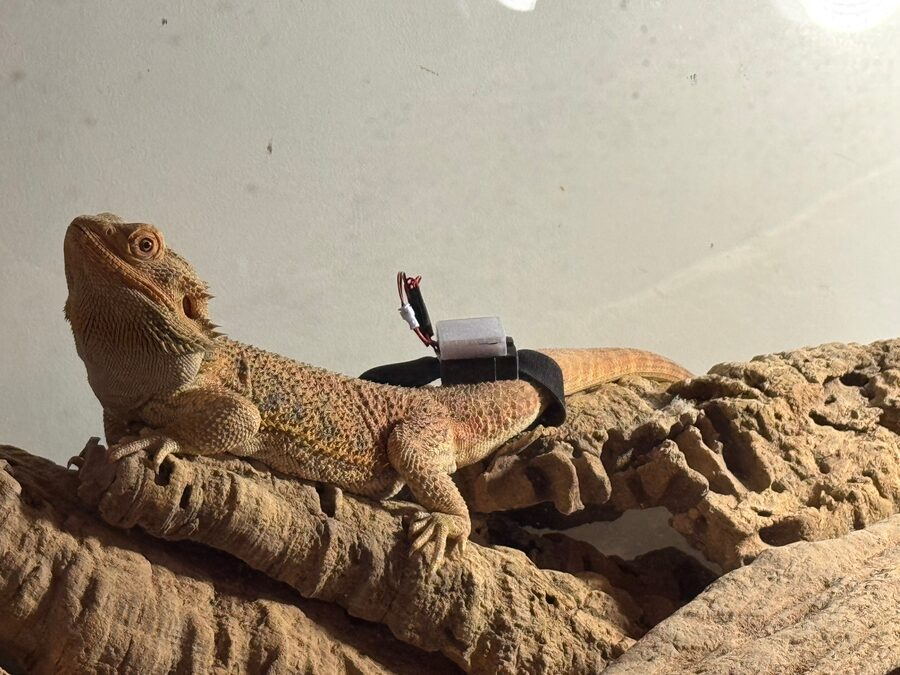
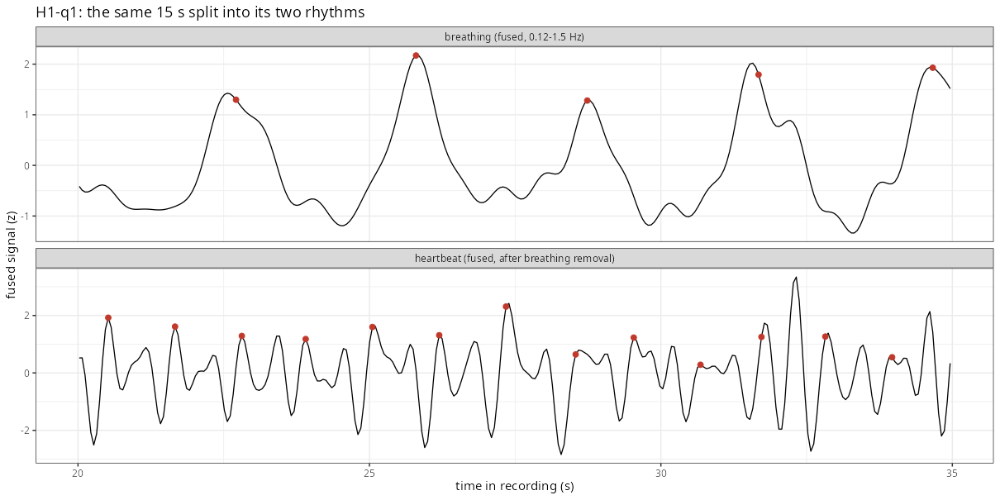

Can a tag that is already riding on an animal to log its movement also tell us
how fast its heart is beating — with no surgery, no electrodes, and no need to
hold the animal still?

That is the question behind **M.A.C.R.A.**. The principle is old and borrowed
from human medicine: every heartbeat propagates
inside the body, and the body recoils. Measure that recoil and you have the
heart rate. Done with a weighing-scale-like device it is called
*ballistocardiography*; done with a gyroscope, as here, it is
*gyrocardiography*. The appeal for conservation work is obvious — the
inertial measurement unit (IMU) needed to see it is the same accelerometer and
gyroscope our [T.A.Co.](taco.qmd) tags already carry.

The honest answer to the aformentioned question so far is: **it works on a human, it reliably measures
breathing in a lizard, and it has not yet resolved a reptile heartbeat.** This
page is a running account of how far we have got and how we know.

## Where the project stands

| Subject | When | Sessions | Outcome |
|---|---|---|---|
| *Pogona vitticeps* (bearded dragon) | 15 Mar 2026 | 3 | One clear rhythm, 7–31 cycles/min — **respiration**, not heartbeat |
| *Varanus komodoensis* (Komodo dragon) | 8 May 2026 | 5 | **No rhythm** resolvable; detection limit quantified |
| *Cyclura nubila caymanensis* (rock iguana) | 8 May 2026 | 4 | **No rhythm** resolvable; detection limit quantified |
| Human (positive control) | 5 Sep 2026 | 6 | Breathing **17–20 /min** *and* heartbeat **52–55 bpm** |

The zoo recordings were made at the Bioparco di Roma.

## A bearded dragon, and a lesson about placement

{width=85%}

Three recordings of a bearded dragon gave a single, strikingly regular
rhythm — the only periodic component anywhere between 6 and 180 cycles per
minute. It ran at 14.7–18.1 cycles/min while the animal rested, slowed to
about 10 as it settled, and rose to 25–28 after the animal had struggled. The
movement itself is tiny: a rocking of the sensor through 0.06–0.3° per cycle,
seen best on the gyroscope.

It is very tempting to call that a heartbeat, but we believe it is not.

In the first two
recordings the strap sat **around the abdomen**, well behind the heart and
exactly where breathing expands the body. The animal was basking, and so warm,
yet the rhythm ran at 7–18 per minute, way below the 40–80 bpm expected of a
warm, resting bearded dragon. In the third recording the strap had been moved
**over the chest**, and still no additional cardiac component appeared once the
main rhythm was removed.

So the rhythm is respiration. That is a useful result in itself — it means the
pipeline and the on-tag estimator are validated as **respiration-rate** tools —
but it is not yet the result we are looking after.

## Reporting a negative result properly

At the Bioparco, neither the Komodo dragon nor the rock iguana produced any
resolvable rhythm in any rest window. The conditions were hard: up to 39 % of
data packets were lost, device timestamps drifted by as much as 3.5 s, and the
animals were moving between 8 % and 100 % of the time, leaving only 274 s of
usable rest for the Komodo and 170 s for the iguana. All twelve heart-rate
monitor exports came back empty, so there is no independent reference.

"We found nothing" is only worth printing if you can say **how small a thing
you would have found**. So the Pogona waveform was scaled and injected back
into each zoo recording to see what would have survived detection. In the two
quietest windows, a rhythm 0.35–0.75× the size of the Pogona signal would have
been picked up; in the noisier ones, even a rhythm two to four times larger
would have been missed. A search down to 1.5 cycles/min, in case these large
lizards simply breathe very slowly, also found nothing.

## The positive control: a human heartbeat

The gap in the project was that a null result in a reptile is uninterpretable
until you know the instrument can see a heartbeat at all. So the same sensor,
at the same settings, went on a person.

Both rhythms came out cleanly: breathing at 17–20 per minute, and a heartbeat
at **52–55 bpm**, seen best on
the gyroscope rather than the accelerometer.

Calling that a heartbeat rather than an artefact of breathing took five
independent checks, all of which agreed: spectral lines at 1–4× the rate; two
distinct complexes per beat, 0.43 s and 0.63 s apart, summing to one 1.1 s
cycle; a beat-to-beat interval far steadier than the breath-to-breath interval
(CV 2–9 % against 12–20 %); a number of beats per breath that varies rather
than locking to a harmonic; and a measurable respiratory sinus arrhythmia of
31 ms.

One finding matters more than the rate itself. Moving the sensor between two
positions on the same person changed the heartbeat amplitude from 2.4–2.7 °/s
peak-to-peak down to 0.13 °/s — **eighteen-fold, on the same heart**. Placement
is not a detail.

### What that implies for the reptiles

With a real heartbeat in hand, it could be scaled and injected into the reptile
recordings. In most rest windows it would have been detected at 0.1–0.5× its
human-chest amplitude; with nothing injected, no reptile window was ever
accepted as a heartbeat.

That converts "we saw no heartbeat" into something quantitative: **any heartbeat
in these animals moved the sensor by less than roughly 0.2–1 °/s
peak-to-peak** — at or below what this IMU could resolve at the settings used.

<!--

## Making it run on the tag

None of this is useful in the field if it needs a laptop. A causal,
low-footprint version of the estimator was written for an on-chip
implementation. It uses the gyroscope only and projects the three axes onto
their principal axis, so it does not care how the tag is oriented.

| | Result |
|---|---|
| Respiration, *Pogona* | 100 % of readings within ±10 % of the offline rate |
| Respiration, human | 97 % within ±10 % |
| Heart rate, human | 100 % within ±10 %, mean error **0.32 bpm** |
| False readings on reptile data | **0 in 849 updates** |
| Cost | ~1.5–2.8 KB RAM, under ~12,000 operations/s |

That budget runs on any Cortex-M0+ or M4 — well inside what a tracking collar
or backpack tag can afford. A 10–20 Hz sampling rate turned out to be enough,
which also saves sensor power.

-->

## Where this leaves things

The method is real, the processing chain is validated end to end, and it
already delivers **respiration rate** — a genuinely useful welfare and
behaviour signal that nobody currently gets from free-ranging reptiles. What it
does not yet deliver is reptile heart rate.

The reasons look tractable rather than fundamental:

- **Sensor resolution.** The recordings used ±16 g and ±2000 °/s, where one
  least-significant bit is 0.49 mg or 0.07 °/s. That is coarse for a signal we
  now know is under 1 °/s. Narrower ranges would buy a great deal.
- **Placement.** The human data showed an 18-fold amplitude swing with
  position. No reptile recording has yet been made with the sensor deliberately
  and verifiably over the heart on a resting, warm animal.
- **Data quality.** Isolated ±256-LSB spikes turned out to be non-atomic
  register reads — 95 % of them fall exactly on a byte boundary. Enabling block
  data update on the IMU should remove them outright.
- **A reference.** Every result so far is inferred. A simultaneous ECG, or even
  a video breath count, would turn inference into validation.

Body size is the one genuinely hard constraint: a cardiac signal is expected to
be far weaker in a tens-of-kilogram Komodo dragon than in a 0.4 kg bearded
dragon, and the animals we most want to monitor are large.

## Collaboration

M.A.C.R.A. is run with colleagues at the University of Rome Tor Vergata, with
the electronics and embedded work shared with the team behind
[T.A.Co.](taco.qmd) If you work on biologging, gyrocardiography, or reptile
physiology and any of this overlaps with your own, [do get in
touch](contacts.qmd).
