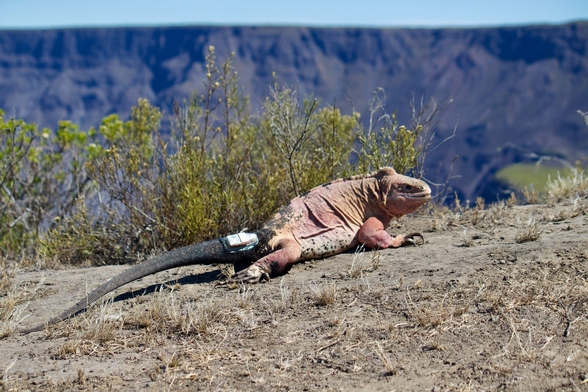
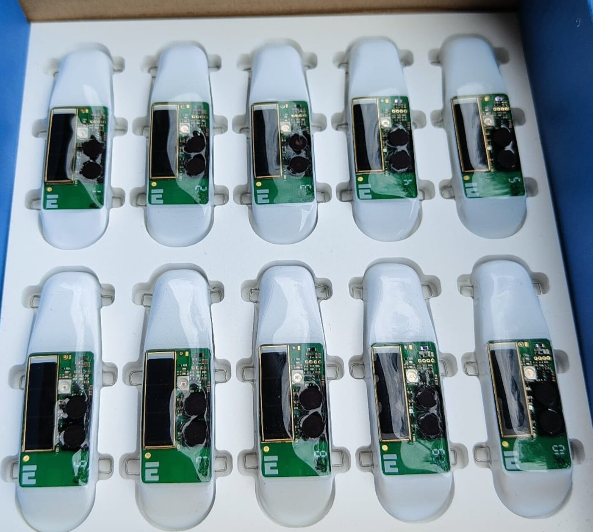

**T.A.Co.** stands for **T**racking **A**nimals and **Co**nservation. It began
in 2015, while I was still working on my PhD on the population genetics of
Caribbean iguanas. Colleagues in Rome had started looking for a way to monitor
the critically endangered Galapagos pink land iguana, *Conolophus marthae*
[@Gentile2012], an animal that is almost impossible to watch. A decade later
that question has turned into a line of work on building tracking devices for
animals nobody would want to follow on foot.

## Why movement is a conservation problem

Every conservation decision is, at bottom, a decision about space. Which
hectares to protect, where to put a fence or remove a predator, where a
translocated animal should be released, whether two populations are connected
or effectively isolated. All of those need to know where animals actually go,
not where we assume they go.

The framework I teach in my [Animal Tracking](teaching.qmd) course comes from
@Nathan2008, who argued that any movement path is produced by four things
acting together: the animal's **internal state** (why move?), its **motion
capacity** (how to move?), its **navigation capacity** (when and where to
move?), and the **external factors** it encounters. A tracking device records
only the path. The whole craft lies in reasoning backwards from that path to
the components that produced it, and in being honest about how far the data
can carry you.

Done well, that reasoning yields the things managers actually ask for: home
ranges and space use, which habitats an animal selects while resting and while
travelling, when it switches between behavioural states, and whether a journey
is a purposeful migration or a random walk that happens to look like one.

## The hardest animal to watch

*Conolophus marthae* was described to science only in 2009 and listed as
Critically Endangered in 2012 [@Gentile2012]. It exists as a single population
on the north-western slope of Wolf Volcano, on Isabela Island, in an area of
less than 25 km², with a census of roughly 200–300 individuals. No hatchlings
have been recorded since 2005, which suggests recruitment has effectively
stopped or at a minimum; introduced feral cats and black rats are the prime suspects. The
species shares the volcano with its congener *C. subcristatus*, with which it
does not hybridise but very likely competes.

The logistics are the other half of the problem. Wolf Volcano rises to about
1700 m and is roughly **150 km from the nearest village**. Up to only a couple of years ago there was no
infrastructure, no cellular network, and communication were possible only by
UHF radio or satellite. A helicopter can cost up to **$3000 an hour**; the
alternative is to hike, which means every litre of water, every battery and
every drop of generator fuel is carried in by hand. A fieldwork station with basic infrastructure and commodities has been established in 2024, but, in practice, fieldwork lasting more than two or three weeks is unattainable [@Loreti2020].

So the animal you most need to observe continuously is the one you can observe
least. That gap is the whole justification for the project.

## A tag that feeds itself

The first device was a GPS wireless sensor node designed around that
constraint [@Loreti2019]. Because nobody is coming back to change a battery,
it harvests its own energy: a small solar cell charging a **supercapacitor**,
which then has to supply two of the hungriest things on the board: the GPS
receiver and a high-current radio booster for long-range transmission.

Supercapacitors rather than lithium-ion was a deliberate choice, and an
ecological one. These devices are deployed in a national park where the
probability of never recovering a unit is real, so the hardware was designed to
be as benign as possible if it is left behind. Alongside position, the node
logs temperature, humidity and UVB,  parameters that matter for a
thermoregulating ectotherm, and that are far more meaningful measured *on the
animal* than inferred from a distant weather station.

## Knowing what the numbers mean

A device that reports a number is not the same as a device that reports a
*true* number. The second paper was an honest audit of our own instrument
[@Loreti2020]. It found that the protective casing biases both the temperature
and the UVB readings, but that the bias is systematic, and so can be corrected
with regressions calibrated under controlled conditions. GPS accuracy degrades
under vegetation and with the tag's orientation on a moving animal, yet still
delivered an average error under **15 m in more than half of all fixes**.

Publishing the limitations of your own hardware is less satisfying than
publishing its successes, but it is what makes the data usable by anyone else.

## From one iguana to twenty-two

The first real test was a single animal. Between 25 September 2019 and
3 March 2020 (159 days) one adult male carried a node and kept reporting
[@Colosimo2022b]. Reconstructing his trajectory and analysing it with
integrated step selection functions revealed an **altitudinal shift of more
than 1000 m**, and showed the path was not random: directed movement, not
wandering. A seasonal migration had been suspected in this species for fifteen
years without ever being observed. One individual does not prove it for a
species, and the paper said so plainly, but it turned a plausible story into
a measured one.

Four years of tracking later, there is an answer. Twenty-two iguanas, seven
males and fifteen females, were followed between 2019 and 2023 — work now in
review, and available as a preprint [@Gargano2026preprint]. **Sixteen of the twenty-two migrate** seasonally
between a small mating area high on the volcano and a larger dispersal area
below it, with males arriving at the mating ground about **48 days before
females**. That makes *C. marthae* a *partially* migratory species — some
individuals move, others do not.

The more interesting question is *why*, and here the tracking data could
discriminate between two competing explanations. The obvious one, that animals
follow shifting peaks of food, does not survive contact with the evidence: the
lower dispersal area turns out to be more productive than the mating area all
year round. Temperature does not explain it either — the two areas differ by
only about 2 °C. What remains is **access to breeding sites**: the animals
climb because that is where they can reproduce, not because it is where the
food is. That is a site-dependent migration, a pattern well described in birds
and mammals and, until now, barely tested in reptiles.

## Finding the nests

Movement data also solved a problem that had blocked conservation action
outright. A head-start programme, rearing hatchlings in captivity past the
age at which cats and rats kill them, was a priority in the species'
2022–2027 conservation plan. But nobody knew where pink iguanas nested, and
until 2021 **not a single hatchling had ever been seen**.

Working from the hypothesis that males and females should separate after
mating, we modelled net displacement against day of year for animals tagged in
April 2021, and looked for movement specific to females [@Gargano2024]. They
had it. Females struck out for a small plateau **inside Wolf Volcano's
caldera**, roughly 400 m below the northern rim, and clustered there once they
arrived.

That was enough to send rangers from the Galapagos National Park Directorate
to the right few hectares. They located individual nests, and shortly
afterwards sighted and collected **the first hatchlings ever recorded for the
species**.

It is worth being plain about what that means. A tracking device did not save
the species. But it converted an unanswerable question into a map reference,
and in doing so it unblocked the single intervention most likely to keep
*C. marthae* from going extinct. That is what the project is for.

## The next generation

The current device is a different animal [@DeLuca2025]. It keeps the
energy-harvesting and long-range LoRa architecture, but adds a sensor suite
aimed at the animal rather than just its coordinates: atmospheric pressure,
volatile compounds, solar irradiation from ultraviolet to infrared, a
microphone and, most ambitiously, **heart rate and respiration**, inferred
ballistocardiographically from an inertial sensor and validated against
Doppler measurements. That physiological strand has become a project of its
own, [M.A.C.R.A.](macra.qmd)

The microphone is there for more than soundscape ecology. Acoustic monitoring
can flag when an animal is near a road or human activity, and gunshot or voice
detection is already used elsewhere to support anti-poaching patrols. A tag
that hears as well as sees is a different kind of conservation instrument.

## Why we do not publish the coordinates

One deliberate omission runs through all of this work: we do not release the
exact GPS positions of individual pink iguanas. Precise locality data for a
flagship critically endangered reptile is itself a conservation risk, and the
trade in trafficked iguanas is well documented, including in work I have
co-authored on how CITES permits are laundered through transit countries
[@Auliya2025]. Data are available on reasonable and documented request to the
senior authors.

## People and funding

T.A.Co. is a collaboration between biologists and electronic engineers at the
University of Rome Tor Vergata, with partners at the Galapagos National Park
Directorate, the San Diego Zoo Wildlife Alliance, the Italian National Research
Council, and the Cayman Islands Department of Environment. Recent development
has been supported by the Darwin Plus Initiative and by the Italian National
Recovery and Resilience Plan through the RESTART programme.

If you work on biologging, low-power embedded sensing, or reptile movement
ecology, I am always glad to [hear from you](contacts.qmd).

# References
